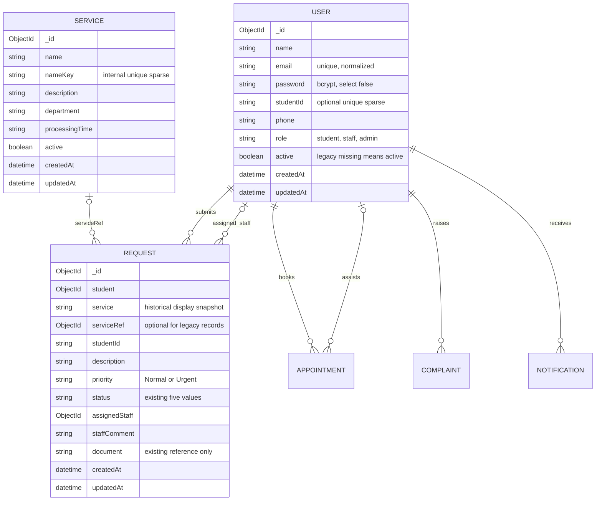

# Database design

The existing MongoDB database and Mongoose model names remain in use. No collection is reset or copied into a second database.

## Relationships and compatibility

User-to-request ownership is authoritative: the authenticated database account supplies student, never the client. A registered student ID, if present, must match the submitted ID. Staff assignments accept only active staff accounts.

The legacy Request.service string remains a historical name. New requests add serviceRef to the existing Service model; this does not invalidate older requests. Renaming a service never changes historical request snapshots.

Safe-delete endpoints set active=false. Service deactivation blocks new requests and removes it from the student catalogue. User deactivation blocks all protected requests immediately. Both can be reversed. References remain valid and historical records stay intact.

Passwords are excluded by default in User queries and explicitly selected only for bcrypt login comparison. API controllers return safe fields after account creation. nameKey is hidden from ordinary service queries and is never accepted from the client.

## Validation and indexes

Email and optional studentId retain existing unique indexes. Sparse studentId allows missing values; blank values are omitted/unset. Services validate case-insensitive names against existing records. New/updated service names receive a normalized unique sparse nameKey, preserving compatibility with older entries.

Request indexes: status+createdAt, student+createdAt and serviceRef. Student and assignedStaff references point to the existing users collection. Pagination bounds and sort allowlists avoid uncontrolled result sizes/fields on admin lists. Text search uses escaped regex; large deployments may replace it with indexed text/Atlas Search.

Appointment, Complaint and Notification now have protected APIs and frontend workflows. Appointment adds optional slot and sparse unique reservedSlot fields; AppointmentSlot adds staff/timestamp availability with a compound unique index. Rejection releases reservedSlot without deleting historical appointments. Existing appointments require no migration.

Request, Appointment and Complaint add hidden notificationEvents arrays. Source writes persist an event with the action; immediate delivery and inbox retries upsert Notification by a sparse unique eventKey, then remove delivered events. Notification adds a user/createdAt index. Existing notifications remain compatible. See ENHANCEMENT-REPORT.md for workflow and verification limits.
